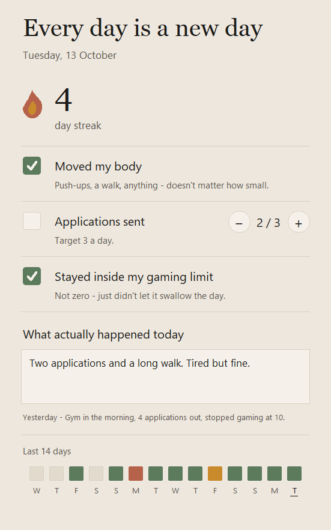

# Every day is a new day

**A nightly check-in that takes about ten seconds.**

Three small boxes, one line about your day, and a streak. That's the whole app.
No login, no account, no cloud, no internet, nothing to `pip install`. One Python
file and one JSON file sitting on your own laptop.

<p align="center">
  
</p>

---

## The idea

Most habit trackers want you to become a better person. This one just wants you
to show up.

The bar for a day counting is deliberately low — **2 out of 3**, not 3 out of 3 —
because a streak you can actually keep beats a perfect system you quietly abandon
in week two. Miss the gym but send your applications and keep gaming sane? Still
a good day. The app says so.

Every night: tap a couple of boxes, type a line, close it. That's it.

---

## What it tracks

| | |
|---|---|
| **Moved my body** | Yes or no. Push-ups, a walk, anything — doesn't matter how small. |
| **Applications sent** | A counter with − and +. Flips to done at **3**. |
| **Stayed inside my gaming limit** | Yes or no. Not zero — just didn't let it swallow the day. |
| **What actually happened today** | One or two lines, for tomorrow-you to read. |

Hit **2 of the 3** and the day counts toward the streak. 🔥

---

## The bits that actually matter

- **The streak doesn't punish you for being early.** It counts back from today,
  or from yesterday if you haven't checked in yet — so it isn't flashing a
  demoralising **0** at you every morning before you've even had coffee.
- **Yesterday's note sits right under today's box.** A note you never get shown
  is just journaling into the void. You read yesterday, then write today.
- **There is no save button.** Every tap, every keystroke writes itself to disk.
  Nothing to remember, nothing to lose by closing the window.
- **It can't eat your data.** Saves go to a temp file and get swapped in
  atomically, so slamming the laptop shut mid-write can't leave you with half a
  file. If the file ever does end up unreadable, it gets copied aside instead of
  overwritten.
- **The last 14 days are a row of squares.** Green for 2+, amber for 1, clay for
  0, and blank for days you never opened it. Hover one to see that day's score
  and note.
- **It's one screen.** No tabs, no sidebar, no dashboard, no settings page.

---

## Running it

```bash
python daily_reset.py
```

Or double-click **Every day is a new day.bat**. Drag it to the desktop or pin it
to the taskbar and it's one click, which is roughly the amount of friction this
whole thing can survive.

Needs **Python 3.10+ with tkinter** — the standard Windows installer already
ships it. There are no dependencies. The entire app is the standard library.

> On the laptop this was built on there's also an `Every day is a new day.lnk`
> shortcut that opens it without even a flicker of a console. It's not in the
> repo — it hardcodes an absolute path to `pythonw.exe`, so it'd break for
> anyone else and the moment Python gets reinstalled. Make your own by pointing
> a shortcut at `pythonw.exe` with `daily_reset.py` as the argument.

---

## Where your data lives

`~/.daily_reset/entries.json`. That's it. That's the entire database.

```json
{
  "2026-10-13": {
    "moved": true,
    "applications": 2,
    "gaming": true,
    "note": "Two applications and a long walk. Tired but fine."
  }
}
```

Plain JSON you can open and read with your own eyes. Back it up by copying one
file. Move laptops by copying one file.

Days you never logged aren't written at all, so *"no entry"* stays genuinely
different from *"a day where I did nothing"* — the history strip shows those
differently on purpose.

**Your entries are never in this repo.** They live in your home folder, not the
project folder, and the data file is gitignored on top of that.

---

## Tweaking it

Everything worth changing sits at the top of `daily_reset.py`:

```python
APP_TARGET = 3     # applications that count as "met"
GOOD_DAY = 2       # how many of the 3 make a day count
HISTORY_DAYS = 14
```

The colour palette is right above those — warm off-white, sage, amber, clay. It
is aggressively not a SaaS dashboard.

---

## What's in the box

```
Every day is a new day/
├── daily_reset.py            # the entire app: storage, scoring, UI
├── Every day is a new day.bat  # double-click launcher
├── docs/screenshot.png
└── README.md
```

Roughly: a `Store` that owns the JSON and the streak maths, a few little
`Canvas` widgets (the checkboxes, the +/− buttons, the flame) drawn by hand
because stock Tk widgets look like 1998, and an `App` that wires them together.
It's DPI-aware, so it renders crisply on a scaled display instead of being
bitmap-stretched into mush.

---

## Deliberately not here

No cloud sync. No accounts. No notifications nagging you at 9pm. No editing past
days — the point is tonight, not retroactively fixing last Tuesday. No fourth,
fifth, sixth habit.

More can get added later. But only once checking in every night is *itself* the
habit.

---

## License

[MIT](./LICENSE) — take it, fork it, change the three habits to your own. If it
helps you show up, that's the whole point.
